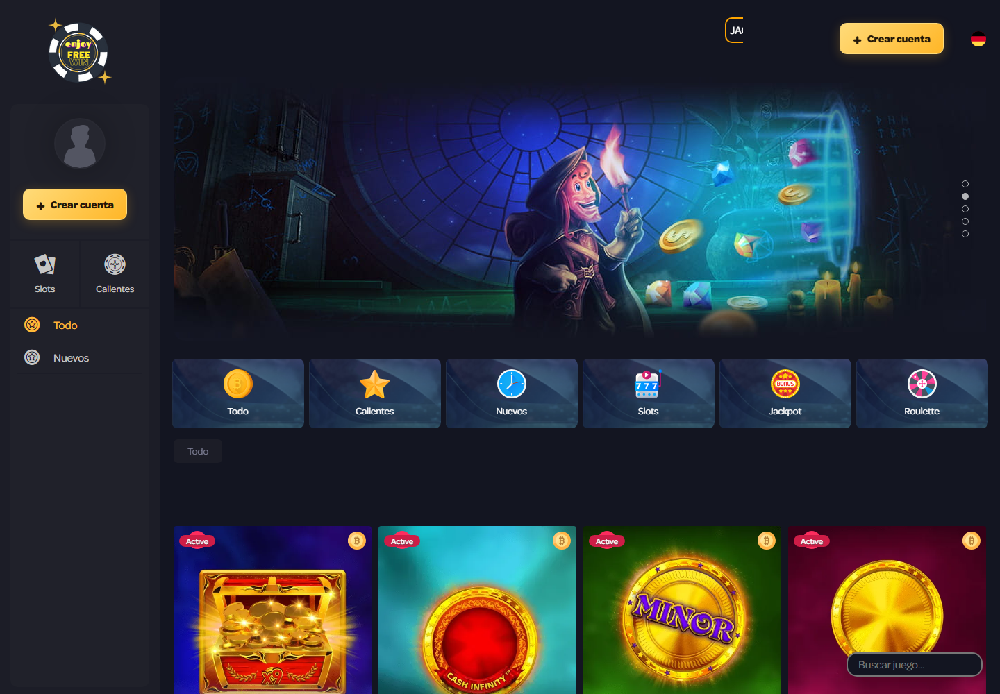
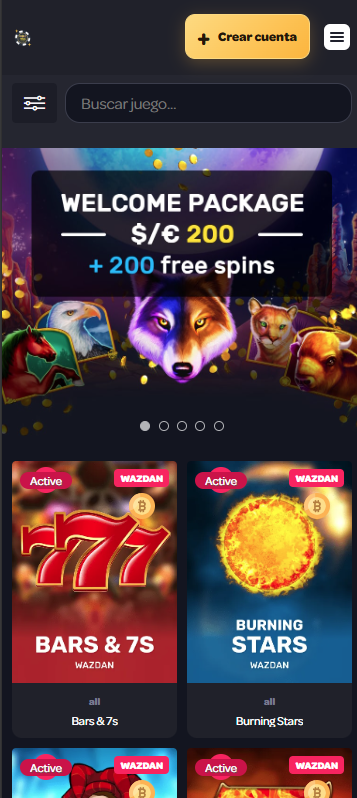
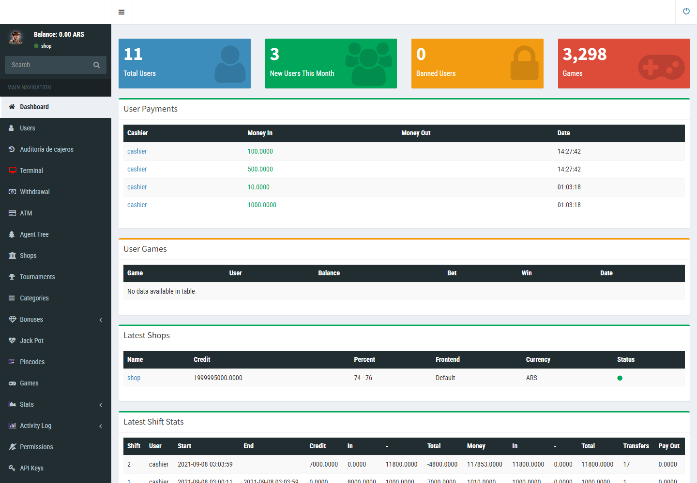

# Casino Sudamérica

### Plataforma de casino online lista para personalizar, operar y escalar

**Lobby responsive · Más de 3.000 juegos · Panel de administración · Gestión de saldos y usuarios**

> Solución disponible para alquiler o adquisición. Se entrega configurada con la identidad visual, moneda y estructura comercial de cada proyecto.

---

## Una experiencia completa para jugadores y operadores

Casino Sudamérica reúne en una sola plataforma un lobby moderno, catálogo de tragamonedas, navegación por categorías y un backoffice desde el que se administra la operación. La interfaz está pensada para funcionar tanto en escritorio como en dispositivos móviles.

## Catálogo amplio y fácil de explorar

La instalación mostrada cuenta con **3.298 juegos cargados**, incluyendo tragamonedas, jackpots, ruleta y otras categorías. Los jugadores pueden buscar títulos, descubrir novedades y acceder rápidamente a los juegos destacados.

- Catálogo organizado por categorías.
- Buscador de juegos integrado.
- Secciones de novedades, destacados y jackpots.
- Banners y promociones personalizables.
- Modalidad de demostración disponible.
- Interfaz preparada para distintas monedas e idiomas.

## Diseñado para jugar desde el celular

La navegación se adapta a pantallas pequeñas, manteniendo visibles el buscador, las promociones y las fichas de cada juego.

  

## Control operativo desde un solo panel

El backoffice permite seguir la actividad general y administrar los principales componentes del casino desde una interfaz centralizada.

### Herramientas de administración

- Alta, edición y control de usuarios.
- Gestión de saldos, ingresos y retiros.
- Roles para administradores, agentes, distribuidores, cajeros y jugadores.
- Árbol de agentes y estructura de tiendas.
- Historial de actividad y auditoría de cajeros.
- Administración de juegos y categorías.
- Configuración de bonos, jackpots, torneos y códigos promocionales.
- Estadísticas de operación y seguimiento de partidas.
- Gestión de permisos y accesos por rol.

## Personalización para cada marca

La plataforma puede adaptarse a la identidad y al modelo comercial del operador:

| Área | Opciones de personalización |
|---|---|
| Marca | Nombre, logotipo, colores, dominio y piezas promocionales |
| Mercado | Idioma, moneda y contenido orientado al público objetivo |
| Catálogo | Categorías, juegos visibles, destacados y orden del lobby |
| Operación | Roles, jerarquías, límites y estructura de agentes |
| Promociones | Banners, bonos, jackpots, torneos y campañas |

## Modalidades comerciales

La solución está disponible bajo dos esquemas:

1. **Alquiler:** puesta en marcha y uso de la plataforma con acompañamiento técnico.
2. **Adquisición:** entrega comercial acordada según el alcance, personalización y necesidades de operación.

El proceso habitual contempla definición de marca, configuración, personalización visual, carga inicial, validación privada y puesta en línea.

## Solicitar una demostración

La demostración completa se realiza de forma privada e incluye un recorrido por el lobby, la experiencia móvil y el panel administrativo.

**Contactame para consultar disponibilidad, alcance y modalidad comercial.**

- **Usuario:** diversion777
- **Correo:** [diversion777@proton.me](mailto:diversion777@proton.me)

---

### Sobre este repositorio

Este es un repositorio público de presentación. **No contiene el código fuente de la plataforma, credenciales, claves, infraestructura ni información técnica sensible.** Las imágenes corresponden a una instalación de demostración y pueden variar según la personalización contratada.

> Producto destinado exclusivamente a operadores habilitados y a personas mayores de edad. La implementación, publicación y operación están sujetas a la normativa y a las licencias aplicables en cada jurisdicción. Promovemos el juego responsable.
